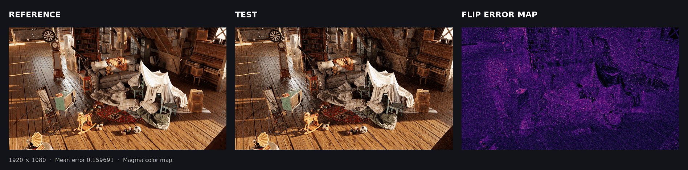

# flip-wgpu

`flip-wgpu` is a Rust crate that implements NVIDIA's
[FLIP project](https://github.com/NVlabs/flip) perceptual image comparison
metric with `wgpu` compute shaders. It has three entry points:

- A reusable Rust API for RGB8 and HDR pixel slices, using a `wgpu::Device` and
  `wgpu::Queue` supplied by your application.
- GPU-buffer and texture methods for applications that already keep image data
  on the device.
- Public WGSL source strings for projects that want to build their own pipeline.

The `flip-wgpu` binary adds PNG and EXR file loading, error-map output, summary
statistics, and the existing HDR exposure options. The crate and its tests do not
build or call the C++ or CUDA implementations.



The sample image pair is from [NVlabs/flip](https://github.com/NVlabs/flip).
`flip-wgpu` produces the error map; the mean FLIP error for this pair is
`0.159691`.

## Use it from another project

Add the GitHub repository as a dependency:

```toml
[dependencies]
flip-wgpu = { git = "https://github.com/mgostIH/flip_wgpu", default-features = false }
wgpu = "30"
```

Disabling default features keeps PNG, EXR, and command-line support out of the
dependency graph. Enable the `cli` feature if you need those helpers. The crate
currently targets the same `wgpu` 30 API as the application.

### Compare decoded images

The evaluator keeps its pipelines and working buffers, so create one for each
image size and viewing configuration and reuse it for multiple pairs:

```rust
use flip_wgpu::{FlipEvaluator, FlipOptions};

async fn compare() -> Result<(), Box<dyn std::error::Error>> {
    let instance = wgpu::Instance::default();
    let adapter = instance
        .request_adapter(&wgpu::RequestAdapterOptions::default())
        .await?;
    let (device, queue) = adapter
        .request_device(&wgpu::DeviceDescriptor::default())
        .await?;

    // Pixels are row-major RGB bytes in sRGB space, with the origin at the top left.
    let reference = [[32, 96, 180], [240, 220, 180]];
    let test = [[32, 96, 180], [220, 205, 170]];
    let mut flip = FlipEvaluator::new(
        &device,
        &queue,
        2,
        1,
        FlipOptions::default(),
    )?;
    let result = flip.evaluate_ldr(&reference, &test)?;
    let mean = result.errors.iter().sum::<f32>() / result.errors.len() as f32;
    println!("mean FLIP error: {mean:.6}");
    println!("error at pixel (1, 0): {:.6}", result.errors[1]);
    Ok(())
}
```

`FlipOptions::default()` uses FLIP's default 67.020645 pixels per degree and the
ACES tone mapper. Set `pixels_per_degree` to match the display and viewing
distance for the images being compared. The library returns one error value per
pixel in row-major order; values range from zero to one.

For HDR, pass linear RGBA `f32` pixels. Alpha is ignored. By default, the
reference image determines the exposure range, as it does in the CLI:

```rust
use flip_wgpu::{FlipEvaluator, FlipOptions, HdrOptions, ToneMapper};

# fn evaluate(device: &wgpu::Device, queue: &wgpu::Queue, reference: &[[f32; 4]], test: &[[f32; 4]]) -> Result<(), Box<dyn std::error::Error>> {
let mut flip = FlipEvaluator::new(
    device,
    queue,
    1920,
    1080,
    FlipOptions { tone_mapper: ToneMapper::Aces, ..Default::default() },
)?;
let result = flip.evaluate_hdr(reference, test, HdrOptions::default())?;
assert_eq!(result.errors.len(), 1920 * 1080);
assert_eq!(result.exposures.len(), result.errors.len());
# Ok(()) }
```

Set any of `start_exposure`, `stop_exposure`, and `exposure_count` in
`HdrOptions` to override automatic HDR settings. Exposure values are in stops;
there must be at least two samples and the start must not exceed the stop.

### Keep input pixels on the GPU

The buffer methods copy input data between buffers on the same device and return
per-pixel results to CPU memory. LDR buffers contain one packed `u32` per pixel:
`red | (green << 8) | (blue << 16)`. HDR buffers contain row-major `[f32; 4]`
pixels with linear RGB. Each input buffer needs `COPY_SRC` usage and must be at
least `width * height * 4` bytes for LDR or `width * height * 16` bytes for HDR.

For renderer-owned textures, use `evaluate_ldr_textures` with
`Rgba8UnormSrgb` or `evaluate_hdr_textures` with `Rgba32Float`. Texture
dimensions must match the evaluator and each texture needs `COPY_SRC` usage.
These calls also keep the inputs on the GPU. HDR texture and buffer methods
require an explicit exposure start, stop, and count; automatic exposure range
selection is available from the HDR slice method.

```rust
use flip_wgpu::{FlipEvaluator, FlipOptions};
use wgpu::util::DeviceExt;

# fn compare(device: &wgpu::Device, queue: &wgpu::Queue) -> Result<(), Box<dyn std::error::Error>> {
let reference = [0x00_60_20_u32, 0x00_b0_80_u32];
let test = [0x00_60_20_u32, 0x00_a0_70_u32];
let reference_bytes: Vec<u8> = reference.iter().flat_map(|pixel| pixel.to_ne_bytes()).collect();
let test_bytes: Vec<u8> = test.iter().flat_map(|pixel| pixel.to_ne_bytes()).collect();
let reference_buffer = device.create_buffer_init(&wgpu::util::BufferInitDescriptor {
    label: Some("reference RGB pixels"),
    contents: &reference_bytes,
    usage: wgpu::BufferUsages::COPY_SRC,
});
let test_buffer = device.create_buffer_init(&wgpu::util::BufferInitDescriptor {
    label: Some("test RGB pixels"),
    contents: &test_bytes,
    usage: wgpu::BufferUsages::COPY_SRC,
});
let mut flip = FlipEvaluator::new(device, queue, 2, 1, FlipOptions::default())?;
let result = flip.evaluate_ldr_buffers(&reference_buffer, &test_buffer)?;
# let _ = result;
# Ok(()) }
```

Result readback is synchronous and waits for the submitted GPU work to finish.

### Use the WGSL source directly

The source strings are available as `flip_wgpu::shaders::LDR_CONVERT`,
`HDR_CONVERT`, `SPATIAL`, `FEATURES`, and `HDR_MAXIMUM`. For example:

```rust
# fn create_shader(device: &wgpu::Device) {
let module = device.create_shader_module(wgpu::ShaderModuleDescriptor {
    label: Some("FLIP LDR conversion"),
    source: wgpu::ShaderSource::Wgsl(flip_wgpu::shaders::LDR_CONVERT.into()),
});
# let _ = module;
# }
```

The constants provide the shader text, not a stable standalone shader API.
The entry points, bind group layouts, and parameter buffer layouts are internal
and are documented in the WGSL files themselves. Use `FlipEvaluator` when you
want FLIP's full filtering and evaluation pipeline without managing those
layouts. The Magma and Viridis lookup arrays are available at
`flip_wgpu::palettes::MAGMA` and `flip_wgpu::palettes::VIRIDIS`.

## Command line

Run the included binary from this repository:

```sh
cargo run --release -- --help
cargo run --release -- reference.png test.png error-map.png
cargo run --release -- --reference reference.exr --test test.exr --tone-mapper hable
```

The CLI writes a Magma error map by default. For HDR it also writes an exposure
map showing which exposure produced the maximum error. `--no-error-map`,
`--no-exposure-map`, and `--no-magma` adjust those outputs. `--directory`,
`--basename`, `--textfile`, and `--csv PATH` control output names and summary
files. `--profile-gpu` reports pass timings when the selected adapter supports
timestamp queries. The positional three-path form and FLIP-style named options
are both supported.

## Tests and fixtures

`cargo test` runs Rust tests using bundled sample images: reference PNG and EXR
pairs, plus the original C++ LDR and HDR result maps as conformance references.
The tests run the wgpu implementation directly; they do not require the FLIP
C++/CUDA programs, Python, or a separately built binary.
If no wgpu adapter is available, the GPU conformance test reports a skip.

The reference result maps are compared with a three-channel tolerance of 3 to
allow small floating-point differences between GPU implementations. The mean
scores are checked against `0.159691` for LDR and `0.283478` for HDR/ACES.

For an optional side-by-side check of native and fallback wgpu adapters on more
image pairs, run the Python utility below. It does not call the original FLIP
executables; Python and Pillow are only needed for this development report.

```sh
uv run scripts/compare_flip.py --fraction 1 --seed 20260925
```

## License and provenance

This project uses the BSD 3-Clause license. The FLIP-derived material and
bundled sample images are from NVIDIA's
[FLIP project](https://github.com/NVlabs/flip). The image files are not owned
by the flip-wgpu contributors. See [LICENSE](LICENSE) and
[THIRD-PARTY-NOTICES.md](THIRD-PARTY-NOTICES.md) for details.
See [API notes](docs/API.md) for input layout and wgpu integration details.
